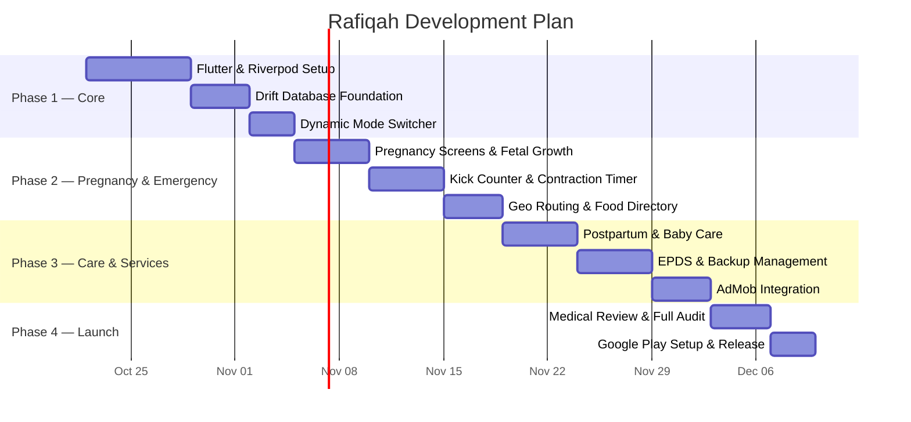

<div align="center">

# 🤰 Rafiqah — Your Smart Companion for Motherhood

### Your Intelligent Guide Through Motherhood

[](https://flutter.dev)
[](https://dart.dev)
[](#-license)
[](#)
[](#)

<br/>

**An Android app built with Flutter that works entirely offline, designed to be the trusted companion for Arab women through every stage — from tracking menstrual cycles, planning for pregnancy, pregnancy itself, to postpartum care.**

<br/>

[🚀 Quick Start](#-quick-start) · [✨ Features](#-key-features) · [🏗️ Architecture](#-architecture) · [📖 Documentation](#-documentation) · [🗺️ Roadmap](#-roadmap)


</div>

---

## 🎯 Why Rafiqah?

> Every woman deserves an app that understands her privacy, protects her data, and provides medically accurate information — without the internet, without servers, and without compromising privacy.

<table>
<tr>
<td width="50%">

### 🔒 Privacy First

All health data is stored **locally only** on your device. No intermediary servers, no sharing with third parties. Backups are encrypted with **AES-256** before being uploaded to your private Google Drive space.

</td>
<td width="50%">

### 🏥 Medical Accuracy

Algorithms built on globally recognized medical protocols (Modified **Naegele's Rule**, **5-1-1 Contraction Rule**, **Edinburgh Postnatal Depression Scale**). No room for pseudoscience.

</td>
</tr>
<tr>
<td width="50%">

### 📴 Fully Offline

All core features — from fetal kick counter to contraction timer to food directory — work **100% offline**.

</td>
<td width="50%">

### 🌙 Designed for Mothers

Interfaces with soothing colors, full Arabic language and **RTL** support, and a supportive tone that respects a mother’s feelings at every stage.

</td>
</tr>
</table>

---

## 🔄 Four Dynamic Modes

The app automatically adapts to the user's physiological stage through a **smart state engine** that smoothly transitions the interface and features:

```
                   ┌──────────────────────────────┐
                   │     Smart Mode Switcher      │
                   │       AppModeNotifier        │
                   └──────────────┬───────────────┘
                                  │
       ┌─────────────────┬────────┴────────┬─────────────────┐
       ▼                 ▼                 ▼                 ▼
┌──────────────┐  ┌──────────────┐  ┌──────────────┐  ┌──────────────┐
│   Menstrual  │  │   Planning   │  │   Pregnancy  │  │  Postpartum  │
│    Cycle     │  │   for Baby   │  │     Care     │  │     Care     │
└──────────────┘  └──────────────┘  └──────────────┘  └──────────────┘
```

<details>
<summary><b>🩸 Menstrual Cycle Tracking Mode</b></summary>

- 📅 Interactive calendar coloring cycle phases (Menstruation → Follicular → Ovulation → Luteal)
- 📝 Daily symptom logging (headaches, mood swings, discharge)
- 🔔 Monthly reminder for self-breast examination after cycle completion
- 📊 Smart predictions for next cycle based on historical averages
</details>

<details>
<summary><b>🌡️ Planning for Pregnancy Mode</b></summary>

- 🎯 Physiologically accurate fertile window calculation (14-day luteal phase stability)
- 📈 Basal Body Temperature (BBT) charting to confirm ovulation
- ⏳ Countdown timer for best conception days (5 days before ovulation + ovulation day)
- 💚 Motivational tips for a healthy lifestyle to boost fertility
</details>

<details>
<summary><b>🤰 Pregnancy Mode</b></summary>

- 🍎 Weekly fetal development (comparison to fruits, length, weight)
- 🦶 **Fetal Kick Counter** — Precise tracking of fetal movement with lethargy alerts
- ⏱️ **Contraction Timer** — 5-1-1 rule algorithm with red alert for hospital visit
- 🏥 **Emergency Routing** — Instant search for nearest hospital/clinic/lab
- 🥗 **Interactive Food Directory** — Local search of +200 food items with medical classification (Safe / Caution / Avoid)
- 🤎 **Skin Spot Reassurance** — Education on the natural and temporary nature of pregnancy-related pigmentation (chloasma, linea nigra)
</details>

<details>
<summary><b>👶 Postpartum & Baby Care Mode</b></summary>

- 🍼 **Breastfeeding Timer** — Tracking feeding times for each breast to ensure balanced nutrition
- 💜 **Edinburgh Postnatal Depression Scale (EPDS)** — 10-question screening with gentle guidance
- 📊 Tracking baby's growth (feeding, sleep, diapers, vaccinations)
- ❤️ Monitoring mother's health (bleeding, physical recovery)
- 🤝 **"Fed is Best" Policy** — Positive support without guilt for breastfeeding mothers
</details>

---

## ✨ Key Features

| Feature               | Description                                                                                     | Technology                          |
|-----------------------|---------------------------------------------------------------------------------------------|------------------------------------|
| 🧮 **Due Date Calculator** | Modified Naegele's rule with cycle length adjustment                                   | `LMP + 280 + (CycleLength - 28)` |
| 🚨 **Contraction Filtering** | Smart alert using 5-1-1 rule for hospital visit                                         | Audio + Red UI Alerts              |
| 🗺️ **Free Geo Routing**      | Search for clinics/hospitals without API cost                                           | Deep Links + `url_launcher`       |
| 🔐 **Encrypted Backups**    | AES-256 encryption before uploading to Google Drive                                      | `drive.appdata` scope               |
| 🍽️ **Smart Food Directory** | +200 food items with medical classification                                            | Local pre-populated database       |
| 📵 **Ad-Free Zones**         | Protection of emergency and mental health screens from ads                              | `AdCooldownManager`                |
| 🌐 **Full Arabic Support**   | RTL interfaces with modern Arabic fonts (Tajawal, Cairo)                                | `Directionality.rtl`                |

---

## 🛡️ Red Lines — Inviolable Guardrails

<table>
<tr>
<td>🚫</td>
<td><b>No Pseudoscience</b></td>
<td>Strictly prohibited to include algorithms claiming to determine baby's gender via coital timing (Shettles method). Only treated as a critical educational article.</td>
</tr>
<tr>
<td>🚫</td>
<td><b>No Ads in Emergency Screens</b></td>
<td>Fetal kick counter, contraction timer, emergency routing, and EPDS screens are strictly ad-free.</td>
</tr>
<tr>
<td>🚫</td>
<td><b>No Health Data on Servers</b></td>
<td>All health data is stored locally. No intermediary servers. No cloud logging without prior encryption.</td>
</tr>
<tr>
<td>🚫</td>
<td><b>No Blame for Mothers</b></td>
<td>"Fed is Best" policy — positive support for breastfeeding without any judgmental language.</td>
</tr>
</table>

---

## 🏗️ Architecture

The app follows a **Feature-First Clean Architecture** with a single-direction data flow:

```
[UI Widget]  ──►  [Riverpod Notifier]  ──►  [Repository / DAO]  ──►  [Drift SQLite DB]
```

### 📂 Folder Structure

```
lib/
├── app/
│   ├── app.dart                      # Root Widget
│   ├── routes.dart                   # Routing Management
│   └── theme/                        # Theme, Soothing Colors, RTL Support
├── core/
│   ├── database/                     # Drift Database & Migrations
│   ├── network/                      # Internet Connection Check
│   ├── security/                     # AES-256 Encryption & Key Management
│   ├── services/
│   │   ├── notification_service.dart # Local Notifications
│   │   ├── geo_routing_service.dart  # Free Geo Routing
│   │   └── backup_service.dart       # Encrypted Backup
│   └── utils/                        # Constants & Medical Calculations
└── features/
    ├── mode_selector/                # Dynamic Mode Switching Engine
    ├── cycle_tracker/                # Menstrual Cycle Tracking
    ├── ttc/                          # Planning for Pregnancy
    ├── pregnancy/                    # Pregnancy Mode
    ├── postpartum/                   # Postpartum Care
    ├── baby_tracker/                 # Baby Care & Growth
    ├── food_directory/               # Interactive Food Directory
    └── settings/                     # Settings & Backup Management
        ├── data/                     # Repositories & Drift DAOs
        ├── domain/                   # UseCases & Entities
        └── presentation/            # Riverpod Providers & UI Screens
```

---

## 🛠️ Tech Stack

<div align="center">

| Layer       | Technology               | Purpose
|-------------|-------------------------|--------
| 📱         | **Flutter** (Dart ≥ 3.3) | UI Framework
| 🔄         | **Riverpod v2**           | State Management (Notifier / AsyncNotifier)
| 🗄️        | **Drift** (SQLite)        | Secure Local Database
| 🔐         | **AES-GCM 256-bit**       | Backup Encryption
| 🔑         | **FlutterSecureStorage**  | Secure Key Storage
| ☁️         | **Google Drive API**      | Cloud Backup (`drive.appdata`)
| 📢         | **Google AdMob**          | Ethical Ads with Restricted Zones
| 🔔         | **flutter_local_notifications** | Local Notifications
| 🗺️        | **url_launcher**          | Free Geo Routing
</div>

---

## 🚀 Quick Start

### Prerequisites

- **Flutter SDK** ≥ 3.3.0
- **Dart SDK** ≥ 3.3.0
- **Android Studio** / **VS Code** with Flutter extensions
- **Android SDK** (API Level 21+)

### Setup and Run

```bash
# 1️⃣ Clone the repository
git clone https://github.com/your-username/rafiqah-app.git
cd rafiqah-app

# 2️⃣ Install dependencies
flutter pub get

# 3️⃣ Generate Drift and Riverpod code (Required after model/table changes)
dart run build_runner build --delete-conflicting-outputs

# 4️⃣ Run static analysis
flutter analyze

# 5️⃣ Run tests
flutter test

# 6️⃣ Run the app
flutter run
```

---

## 🧪 Medical Algorithms

<details>
<summary><b>🧮 Due Date Calculator — Modified Naegele's Rule</b></summary>

```dart
/// Modified Naegele's rule with cycle length adjustment
DateTime calculateEDD({required DateTime lmp, required int cycleLength}) {
  final int adjustment = cycleLength - 28;
  return lmp.add(Duration(days: 280 + adjustment));
}
```

> **Formula:** `EDD = LMP + 280 days + (CycleLength - 28)`

> This modified formula uses the user's actual cycle length instead of the fixed assumption (28 days) for more accurate results.

</details>

<details>
<summary><b>🎯 Fertile Window & Ovulation</b></summary>

- **Ovulation Day** = Expected next cycle date − 14 days (luteal phase stability)
- **Fertile Window** = 5 days before ovulation → ovulation day + 24 hours
</details>

<details>
<summary><b>🚨 Contraction Rule — Rule 5-1-1</b></summary>

A red alert for immediate hospital visit is triggered when **all three conditions** are met:

| Condition               | Value
|-------------------------|------
| Time between contractions | ≤ **5 minutes**
| Duration of each contraction | ≥ **60 seconds**
| Consistency of pattern   | ≥ **1 hour** (3 contractions minimum)
</details>

---

## 📖 Documentation

| File                          | Content
|-------------------------------|----------------------------------------------|
| 📋 [`CLAUDE_PROJECT_INSTRUCTIONS.md`](docs/CLAUDE_PROJECT_INSTRUCTIONS.md) | Extended operational guide and detailed instructions
| 🏗️ [`ARCHITECTURE.md`](docs/ARCHITECTURE.md) | Folder structure, architecture, and Arabic theme
| 🗄️ [`DATABASE.md`](docs/DATABASE.md) | Drift tables, relationships, queries, and migrations
| 🧬 [`FEATURES_SPEC.md`](docs/FEATURES_SPEC.md) | Medical equations, 5-1-1 rule, and food directory
| 🔌 [`INTEGRATIONS.md`](docs/INTEGRATIONS.md) | AdMob ads, free maps, and Google Drive backups
| ⚖️ [`COMPLIANCE_AND_LEGAL.md`](docs/COMPLIANCE_AND_LEGAL.md) | Medical disclaimer and privacy/compliance policies
| 🗺️ [`ROADMAP.md`](docs/ROADMAP.md) | Project phases and sprint planning

---

## 🗺️ Roadmap



---

## ⚖️ Compliance

<table>
<tr>
<td>📋</td>
<td><b>App Classification</b></td>
<td>Health & Fitness (Not a Medical Device)</td>
</tr>
<tr>
<td>🏥</td>
<td><b>Mandatory Medical Disclaimer</b></td>
<td>Non-skippable dialog at first installation</td>
</tr>
<tr>
<td>🔒</td>
<td><b>Data Privacy</b></td>
<td>Structurally compliant with GDPR and HIPAA — no intermediary servers</td>
</tr>
<tr>
<td>🗑️</td>
<td><b>Right to Erasure</b></td>
<td>One-click option to delete all data (Right to be Forgotten)</td>
</tr>
<tr>
<td>🛡️</td>
<td><b>Health Data</b></td>
<td>Never shared with third parties — exclusive local storage</td>
</tr>
</table>

---

## 💰 Monetization

The app uses **Google AdMob** with strict ethical policies:

- ✅ **Banner Ads** — Only at the bottom of article screens and food directory
- ✅ **Native Ads** — Integrated cards matching the theme within article lists
- ✅ **Interstitial Ads** — Between major sections with a minimum 4-minute gap
- 🚫 **No Ads** in: Fetal kick counter, contraction timer, emergency screens, and EPDS

---

## 🤝 Contributing

Contributions are welcome! Please follow these guidelines:

1. **Fork** the repository
2. Create a new branch: `git checkout -b feature/amazing-feature`
3. Make your changes while adhering to **Clean Architecture**
4. Start each code file with its full path as a comment:
   ```dart
   // lib/features/pregnancy/presentation/screens/kick_counter_screen.dart
   ```
5. Ensure `flutter analyze` and `flutter test` pass
6. Submit a **Pull Request** with a clear description

---

## ⚠️ Medical Disclaimer

> [!CAUTION]
> The content, calculations, and tools in **Rafiqah** are for **educational, informational, and organizational purposes only** and should not be considered medical advice or a substitute for professional medical examination and consultation.

> In case of any emergency symptoms or unusual signs (such as sudden bleeding, lack of fetal movement, severe pain), please **immediately** go to the nearest hospital or contact emergency services.

---

## 📄 License

This project is under a proprietary license. All rights reserved.
For commercial licensing inquiries, please contact via email.

---

## 💖 Support & Coffee

If you find this project useful or would like to support its continuous development and maintenance, consider buying me a coffee! Your contribution helps keep this project open-source and privacy-focused.

<div align="center">

[](https://ko-fi.com/E1A528VA4K)

</div>

---

<div align="center">

**Made with 💜 for every mother**

<sub>Rafiqah — Because every motherhood journey deserves a smart companion</sub>

</div>
