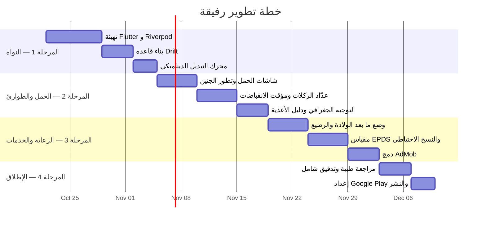

<div align="center">

# 🤰 رفيقة — Rafiqah

### رفيقتك الذكية في رحلة الأمومة

[](https://flutter.dev)
[](https://dart.dev)
[](#-الترخيص-license)
[](#)
[](#)

<br/>

**تطبيق أندرويد متكامل مبني بـ Flutter يعمل بالكامل بدون إنترنت، مُصمَّم ليكون الرفيق الموثوق للمرأة العربية عبر كل مرحلة — من متابعة الدورة الشهرية، مرورًا بالتخطيط للحمل والحمل نفسه، وصولًا إلى رعاية ما بعد الولادة.**

<br/>

[🚀 البدء السريع](#-البدء-السريع-quick-start) · [✨ المزايا](#-المزايا-الرئيسية) · [🏗️ المعمارية](#%EF%B8%8F-المعمارية-architecture) · [📖 التوثيق](#-التوثيق-documentation) · [🗺️ خارطة الطريق](#%EF%B8%8F-خارطة-الطريق-roadmap)

</div>

---

## 🎯 لماذا رفيقة؟

> تستحق كل امرأة تطبيقًا يفهم خصوصيتها، يحمي بياناتها، ويقدم لها معلومات طبية موثوقة — بدون إنترنت، بدون خوادم، وبدون تنازل عن الخصوصية.

<table>
<tr>
<td width="50%">

### 🔒 الخصوصية أولًا
جميع البيانات الصحية تُخزَّن **محليًا فقط** على جهازك. لا خوادم وسيطة، لا مشاركة مع أطراف ثالثة. النسخ الاحتياطي مُشفَّر بـ **AES-256** قبل رفعه إلى مساحتك الخاصة على Google Drive.

</td>
<td width="50%">

### 🏥 دقة طبية
خوارزميات مبنية على بروتوكولات طبية معتمدة عالميًا (قاعدة **Naegele المعدلة**، خوارزمية **5-1-1** لفرز الانقباضات، مقياس **إيدنبرة EPDS**). لا مكان للعلوم الزائفة.

</td>
</tr>
<tr>
<td width="50%">

### 📴 يعمل بدون إنترنت
كل الميزات الحيوية — من عدّاد الركلات إلى مؤقت الانقباضات إلى دليل الأغذية — تعمل بنسبة **100%** بدون اتصال بالإنترنت.

</td>
<td width="50%">

### 🌙 تجربة مُصمَّمة للأم
واجهات بألوان مهدئة ومريحة للعين، دعم كامل للغة العربية و **RTL**، ونبرة نفسية داعمة تحترم مشاعر الأم في كل مرحلة.

</td>
</tr>
</table>

---

## 🔄 الأوضاع الأربعة الديناميكية

يتكيّف التطبيق تلقائيًا مع المرحلة الفسيولوجية للمستخدمة عبر **محرك حالة ذكي** يُبدِّل الواجهة والميزات بسلاسة:

```
                    ┌────────────────────────────┐
                    │    🔄 محرك التبديل الذكي    │
                    │      AppModeNotifier        │
                    └─────────────┬──────────────┘
                                  │
       ┌──────────────┬───────────┴──────────┬──────────────┐
       ▼              ▼                      ▼              ▼
 ┌───────────┐  ┌───────────┐        ┌───────────┐  ┌───────────┐
 │  🩸 الدورة │  │ 🌡️ التخطيط│        │ 🤰 الحمل  │  │ 👶 الأمومة │
 │  الشهرية  │  │  للحمل    │        │           │  │  الجديدة  │
 └───────────┘  └───────────┘        └───────────┘  └───────────┘
```

<details>
<summary><b>🩸 وضع متابعة الدورة الشهرية — Period Tracker</b></summary>

- 📅 تقويم تفاعلي يلوّن مراحل الدورة (حيض → طور جرابي → تبويض → طور أصفري)
- 📝 تسجيل يومي للأعراض (صداع، تقلبات مزاجية، إفرازات)
- 🔔 تذكير شهري بالفحص الذاتي للثدي بعد انتهاء الدورة بـ 3 أيام
- 📊 تنبؤات ذكية بموعد الدورة القادمة بناءً على متوسط دوراتك السابقة

</details>

<details>
<summary><b>🌡️ وضع التخطيط للحمل — Trying to Conceive (TTC)</b></summary>

- 🎯 حساب نافذة الخصوبة بدقة فسيولوجية (ثبات الطور الأصفري 14 يومًا)
- 📈 رسم بياني لحرارة الجسم القاعدية (BBT) لتأكيد حدوث التبويض
- ⏳ عد تنازلي لأفضل أيام الإخصاب (5 أيام قبل التبويض + يوم التبويض)
- 💚 نصائح تحفيزية لنمط حياة صحي يزيد فرص الحمل

</details>

<details>
<summary><b>🤰 وضع أنا حامل — Pregnancy Mode</b></summary>

- 🍎 تطور الجنين أسبوعيًا (حجم مقارن بالفواكه، الطول، الوزن)
- 🦶 **عدّاد ركلات الجنين** — تسجيل دقيق لحركة الجنين مع إنذار بالخمول
- ⏱️ **مؤقت الانقباضات** — تطبيق خوارزمية **5-1-1** مع تنبيه أحمر للتوجه للمستشفى
- 🏥 **توجيه طوارئ** — البحث الفوري عن أقرب مستشفى/عيادة/مختبر
- 🥗 **دليل أغذية تفاعلي** — بحث محلي فوري في +200 صنف مع تصنيف طبي (آمن / بحذر / ممنوع)
- 🤎 **ركن التطمين الجلدي** — توعية بأن تصبغات الحمل (الكلف، الخط الأسود) طبيعية ومؤقتة

</details>

<details>
<summary><b>👶 وضع أم جديدة — Postpartum & Baby Care</b></summary>

- 🍼 **مؤقت الرضاعة** — تتبع وقت الرضاعة لكل ثدي لضمان توازن التغذية
- 💜 **مقياس إيدنبرة (EPDS)** — فحص اكتئاب ما بعد الولادة بـ 10 أسئلة مع توجيه هادئ
- 📊 تتبع نمو الرضيع (تغذية، نوم، حفاضات، تطعيمات)
- ❤️ متابعة صحة الأم (النزيف، التعافي الجسدي)
- 🤝 سياسة **"Fed is Best"** — دعم إيجابي بدون لوم للأمهات

</details>

---

## ✨ المزايا الرئيسية

| الميزة | الوصف | التقنية |
|:---|:---|:---|
| 🧮 **حاسبة الولادة** | قاعدة Naegele المعدلة مع تصحيح طول الدورة | `LMP + 280 + (CycleLength - 28)` |
| 🚨 **فرز الانقباضات** | إنذار ذكي بخوارزمية 5-1-1 للتوجه للمستشفى | تنبيه صوتي + واجهة حمراء |
| 🗺️ **توجيه جغرافي مجاني** | البحث عن عيادات ومستشفيات بدون تكلفة API | Deep Links + `url_launcher` |
| 🔐 **نسخ احتياطي مشفر** | تشفير AES-256 قبل الرفع لـ Google Drive | `drive.appdata` scope |
| 🍽️ **دليل أغذية ذكي** | +200 صنف غذائي بتصنيف طبي | قاعدة بيانات محلية مسبقة التعبئة |
| 📵 **مناطق بدون إعلانات** | حماية شاشات الطوارئ والصحة النفسية من الإعلانات | `AdCooldownManager` |
| 🌐 **دعم كامل للعربية** | واجهات RTL بخطوط عربية حديثة (Tajawal / Cairo) | `Directionality.rtl` |

---

## 🛡️ الخطوط الحمراء — Inviolable Guardrails

<table>
<tr>
<td>🚫</td>
<td><b>لا علوم زائفة</b></td>
<td>ممنوع قطعيًا تضمين خوارزميات تزعم تحديد جنس المولود بتوقيت الجماع (شيتلز). تُعالَج فقط كمقال نقدي تثقيفي.</td>
</tr>
<tr>
<td>🚫</td>
<td><b>لا إعلانات في الطوارئ</b></td>
<td>شاشات عدّاد الركلات، مؤقت الانقباضات، توجيه الطوارئ، ومقياس EPDS — مناطق محظورة تمامًا من الإعلانات.</td>
</tr>
<tr>
<td>🚫</td>
<td><b>لا بيانات على خوادم</b></td>
<td>كل البيانات الصحية محلية. لا خوادم وسيطة. لا تسجيل سحابي بدون تشفير مسبق.</td>
</tr>
<tr>
<td>🚫</td>
<td><b>لا لوم للأمهات</b></td>
<td>سياسة "Fed is Best" — دعم إيجابي للرضاعة بدون أي عبارة قد تُشعر الأم بالذنب.</td>
</tr>
</table>

---

## 🏗️ المعمارية — Architecture

يعتمد التطبيق على **Feature-First Clean Architecture** مع تدفق بيانات وحيد الاتجاه:

```
 [UI Widget]  ──►  [Riverpod Notifier]  ──►  [Repository / DAO]  ──►  [Drift SQLite DB]
```

### 📂 هيكل المجلدات

```
lib/
├── app/
│   ├── app.dart                      # Root Widget
│   ├── routes.dart                   # إدارة التنقل
│   └── theme/                        # الثيم، الألوان المهدئة، ودعم RTL
├── core/
│   ├── database/                     # Drift Database & Migrations
│   ├── network/                      # فحص الاتصال بالإنترنت
│   ├── security/                     # AES-256 التشفير وإدارة المفاتيح
│   ├── services/
│   │   ├── notification_service.dart # الإشعارات المحلية
│   │   ├── geo_routing_service.dart  # التوجيه الجغرافي المجاني
│   │   └── backup_service.dart       # النسخ الاحتياطي المشفر
│   └── utils/                        # الثوابت والحسابات الطبية
└── features/
    ├── mode_selector/                # محرك التبديل بين الأوضاع الأربعة
    ├── cycle_tracker/                # متابعة الدورة الشهرية
    ├── ttc/                          # التخطيط للحمل
    ├── pregnancy/                    # وضع الحمل
    ├── postpartum/                   # ما بعد الولادة
    ├── baby_tracker/                 # رعاية وتتبع الرضيع
    ├── food_directory/               # دليل الأغذية التفاعلي
    └── settings/                     # الإعدادات والنسخ الاحتياطي
        ├── data/                     # Repositories & Drift DAOs
        ├── domain/                   # UseCases & Entities
        └── presentation/            # Riverpod Providers & UI Screens
```

---

## 🛠️ الحزمة التقنية — Tech Stack

<div align="center">

| الطبقة | التقنية | الغرض |
|:---:|:---|:---|
| 📱 | **Flutter** (Dart ≥ 3.3) | إطار بناء واجهات المستخدم |
| 🔄 | **Riverpod v2** | إدارة الحالة (Notifier / AsyncNotifier) |
| 🗄️ | **Drift** (SQLite) | قاعدة بيانات محلية آمنة الأنماط |
| 🔐 | **AES-GCM 256-bit** | تشفير النسخ الاحتياطي |
| 🔑 | **FlutterSecureStorage** | تخزين آمن للمفاتيح |
| ☁️ | **Google Drive API** | نسخ احتياطي سحابي (`drive.appdata`) |
| 📢 | **Google AdMob** | إعلانات ذكية مع مناطق محظورة |
| 🔔 | **flutter_local_notifications** | تذكيرات وتنبيهات محلية |
| 🗺️ | **url_launcher** | توجيه جغرافي بدون تكلفة API |

</div>

---

## 🚀 البدء السريع — Quick Start

### المتطلبات المسبقة

- **Flutter SDK** ≥ 3.3.0
- **Dart SDK** ≥ 3.3.0
- **Android Studio** / **VS Code** مع إضافات Flutter
- **Android SDK** (API Level 21+)

### التثبيت والتشغيل

```bash
# 1️⃣ استنساخ المستودع
git clone https://github.com/billelaggab/rafiqah.git
cd rafiqah

# 2️⃣ تثبيت الحزم
flutter pub get

# 3️⃣ توليد أكواد Drift و Riverpod (إلزامي بعد كل تعديل على النماذج)
dart run build_runner build --delete-conflicting-outputs

# 4️⃣ فحص الأخطاء الاستاتيكية
flutter analyze

# 5️⃣ تشغيل الاختبارات
flutter test

# 6️⃣ تشغيل التطبيق
flutter run
```

---

## 🧪 الخوارزميات الطبية المعتمدة

<details>
<summary><b>🧮 حساب موعد الولادة المتوقع — Modified Naegele's Rule</b></summary>

```dart
/// قاعدة Naegele المعدلة مع تصحيح طول الدورة الفعلي
DateTime calculateEDD({required DateTime lmp, required int cycleLength}) {
  final int adjustment = cycleLength - 28;
  return lmp.add(Duration(days: 280 + adjustment));
}
```

> **الصيغة:** `EDD = LMP + 280 يومًا + (طول الدورة - 28)`
>
> تستخدم هذه الصيغة المعدلة طول الدورة الحقيقي للمستخدمة بدلًا من الافتراض الثابت (28 يومًا) لنتائج أدق.

</details>

<details>
<summary><b>🎯 نافذة الخصوبة والتبويض — Ovulation & Fertile Window</b></summary>

- **يوم التبويض** = تاريخ الدورة القادمة المتوقعة − 14 يومًا (ثبات الطور الأصفري)
- **نافذة الإخصاب** = 5 أيام قبل التبويض ← يوم التبويض + 24 ساعة

</details>

<details>
<summary><b>🚨 خوارزمية فرز الانقباضات — Rule 5-1-1</b></summary>

يُطلَق تنبيه أحمر بالتوجه الفوري للمستشفى عند تحقق **الشروط الثلاثة معًا**:

| الشرط | القيمة |
|:---|:---|
| الفارق الزمني بين كل انقباضتين | ≤ **5 دقائق** |
| مدة الانقباضة الواحدة | ≥ **60 ثانية** |
| استمرار النمط بانتظام | ≥ **ساعة كاملة** (3 انقباضات كحد أدنى) |

</details>

---

## 📖 التوثيق — Documentation

| الملف | المحتوى |
|:---|:---|
| 📋 [`CLAUDE_PROJECT_INSTRUCTIONS.md`](docs/CLAUDE_PROJECT_INSTRUCTIONS.md) | الدليل التشغيلي الموسع والتعليمات المفصلة |
| 🏗️ [`ARCHITECTURE.md`](docs/ARCHITECTURE.md) | هيكل المجلدات، المعمارية، والثيم العربي |
| 🗄️ [`DATABASE.md`](docs/DATABASE.md) | جداول Drift، العلاقات، الاستعلامات، والهجرة |
| 🧬 [`FEATURES_SPEC.md`](docs/FEATURES_SPEC.md) | المعادلات الطبية، خوارزمية 5-1-1، ودليل الأغذية |
| 🔌 [`INTEGRATIONS.md`](docs/INTEGRATIONS.md) | إعلانات AdMob، الخرائط المجانية، ونسخ Drive |
| ⚖️ [`COMPLIANCE_AND_LEGAL.md`](docs/COMPLIANCE_AND_LEGAL.md) | الإقرار الطبي وسياسات الخصوصية والمتجر |
| 🗺️ [`ROADMAP.md`](docs/ROADMAP.md) | مراحل المشروع وخطة المهام (Sprints) |

---

## 🗺️ خارطة الطريق — Roadmap



---

## ⚖️ الامتثال القانوني — Compliance

<table>
<tr>
<td>📋</td>
<td><b>تصنيف التطبيق</b></td>
<td>Health & Fitness (ليس جهازًا طبيًا)</td>
</tr>
<tr>
<td>🏥</td>
<td><b>إقرار طبي إلزامي</b></td>
<td>نافذة حوارية غير قابلة للتخطي عند التثبيت الأول</td>
</tr>
<tr>
<td>🔒</td>
<td><b>خصوصية البيانات</b></td>
<td>متوافق هيكليًا مع GDPR و HIPAA — لا خوادم وسيطة</td>
</tr>
<tr>
<td>🗑️</td>
<td><b>حق المحو</b></td>
<td>زر مسح كامل لجميع البيانات بنقرة واحدة (Right to be Forgotten)</td>
</tr>
<tr>
<td>🛡️</td>
<td><b>بيانات صحية</b></td>
<td>لا تُشارَك مع أي طرف ثالث — تخزين محلي حصري</td>
</tr>
</table>

---

## 💰 نموذج الربحية — Monetization

يعتمد التطبيق على إعلانات **Google AdMob** مع سياسة أخلاقية صارمة:

- ✅ **إعلانات البانر** — أسفل شاشات المقالات ودليل الأغذية فقط
- ✅ **إعلانات مدمجة (Native)** — بطاقات متناسقة مع الثيم داخل قوائم المقالات
- ✅ **إعلانات بينية (Interstitial)** — بين الأقسام الكبرى بفاصل ≥ 4 دقائق
- 🚫 **بدون إعلانات** في: عدّاد الركلات، مؤقت الانقباضات، شاشة الطوارئ، مقياس EPDS

---

## 🤝 المساهمة — Contributing

نرحب بالمساهمات! يرجى اتباع الإرشادات التالية:

1. **Fork** المستودع
2. أنشئ فرعًا جديدًا: `git checkout -b feature/amazing-feature`
3. نفِّذ تعديلاتك مع الالتزام بـ **Clean Architecture**
4. ابدأ كل ملف كود بمساره الكامل كتعليق:
   ```dart
   // lib/features/pregnancy/presentation/screens/kick_counter_screen.dart
   ```
5. تأكد من نجاح `flutter analyze` و `flutter test`
6. أرسل **Pull Request** مع وصف واضح

---

## ⚠️ إخلاء المسؤولية الطبية

> [!CAUTION]
> المحتوى، الحسابات، والأدوات المتوفرة في تطبيق **رفيقة** هي لأغراض **تثقيفية وإرشادية وتنظيمية فقط**، ولا يمكن اعتبارها بأي حال من الأحوال تشخيصًا طبيًا، أو بديلًا عن الفحص السريري واستشارة الطبيبة المختصة.
>
> في حال شعورك بأي أعراض طارئة أو غير معتادة (كنزيف مفاجئ، انقطاع حركة الجنين، آلام حادة)، يجب التوجه **فورًا** إلى أقرب مشفى أو الاتصال بالطوارئ.

---

## 📄 الترخيص — License

هذا المشروع خاضع لترخيص خاص. جميع الحقوق محفوظة.  
للاستفسار حول الترخيص التجاري، يرجى التواصل عبر البريد الإلكتروني.

---

<div align="center">

**صُنع بـ 💜 من أجل كل أم**

<sub>رفيقة — لأن كل رحلة أمومة تستحق رفيقة ذكية تفهمها</sub>

</div>
